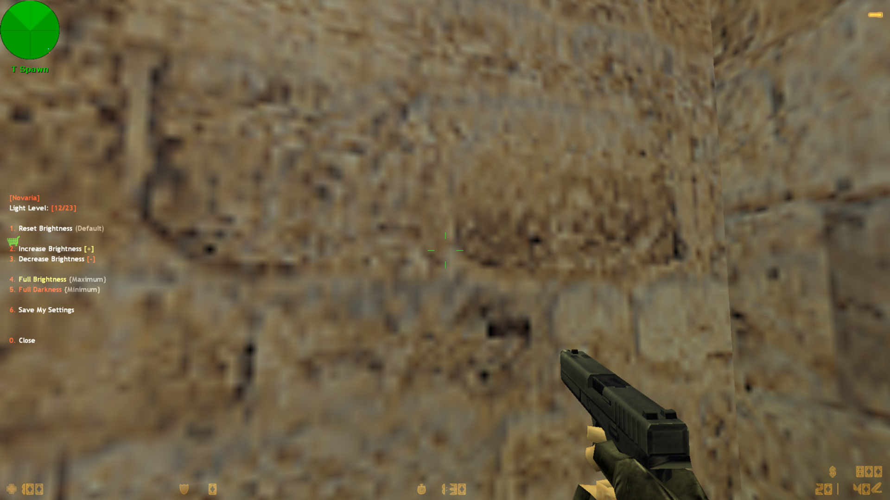

# Novaria - Gelişmiş Işık Ayarları Eklentisi (AMX Mod X)

## 🇰🇷 한국어

안녕하세요, 사랑하는 한국 친구들! 💚

먼저 한국의 모든 게이머와 커뮤니티 여러분께 진심 어린 사랑과 존경의 인사를 전하고 싶습니다. 여러분의 열정과 실력은 언제나 저희에게 큰 영감을 줍니다. 이 작은 플러그인이 여러분의 게임 경험에 조금이나마 도움이 되기를 바라는 마음으로 만들었습니다. 항상 응원합니다, 사랑해요 한국! 🇰🇷❤️

### 플러그인 소개

**Novaria Gelişmiş Işık Ayarları**, Counter-Strike 1.6 (AMX Mod X) 서버를 위한 화면 밝기 조절 플러그인입니다. 어두운 맵에서도 플레이어가 화면 밝기를 개인적으로 조절할 수 있도록 해주며, 설정은 저장되어 다음 접속 시에도 유지됩니다.

**주요 기능**
- `/isik` 또는 `.isik` 명령어로 메뉴 열기
- 23단계 밝기 조절 (증가 / 감소)
- 최대 밝기 / 최소 밝기 즉시 적용
- 설정 저장 (nVault 사용) — 재접속 시 자동 복원
- 리스폰 및 **사망 시에도 즉시** 밝기 적용
- 다국어 지원: 영어(EN), 터키어(TR), 한국어(KO) — 플레이어의 게임 언어에 따라 자동 전환

### 설치 방법
1. `addons/amxmodx/scripting/advanced_light_shift.sma` 및 컴파일된 `.amxx` 파일을 서버에 업로드하세요.
2. `addons/amxmodx/data/lang/gelismis_isikayari.txt` 언어 파일을 함께 업로드하세요.
3. `plugins.ini` 파일에 플러그인을 추가하세요.
4. 서버를 재시작하거나 플러그인을 다시 로드하세요.

---

## 🇹🇷 Türkçe

### Eklenti Hakkında

**Novaria Gelişmiş Işık Ayarları**, Counter-Strike 1.6 (AMX Mod X) sunucuları için geliştirilmiş bir ekran parlaklığı ayarlama eklentisidir. Karanlık haritalarda oyunculara ekran parlaklığını kişisel olarak ayarlama imkanı sunar ve ayarlar kalıcı olarak kaydedilir.

**Özellikler**
- `/isik` veya `.isik` yazarak menüyü açma
- 23 kademeli parlaklık ayarı (arttır / azalt)
- Tam Aydınlık / Tam Karanlık anında uygulanır
- Ayarlar nVault ile kaydedilir — sunucuya tekrar bağlanınca otomatik yüklenir
- Spawn olduğunda ve **öldüğünde bile** ışık ayarı anında uygulanır
- Çoklu dil desteği: İngilizce (EN), Türkçe (TR), Korece (KO) — oyuncunun oyun dili ayarına göre otomatik değişir

### Kurulum
1. `addons/amxmodx/scripting/advanced_light_shift.sma` ve derlenmiş `.amxx` dosyasını sunucuya yükleyin.
2. `addons/amxmodx/data/lang/gelismis_isikayari.txt` dil dosyasını da yükleyin.
3. `plugins.ini` dosyasına eklentiyi ekleyin.
4. Sunucuyu yeniden başlatın veya eklentiyi reload edin.

### Ekran Görüntüsü

---

*Made with ❤️ by Novaria*
